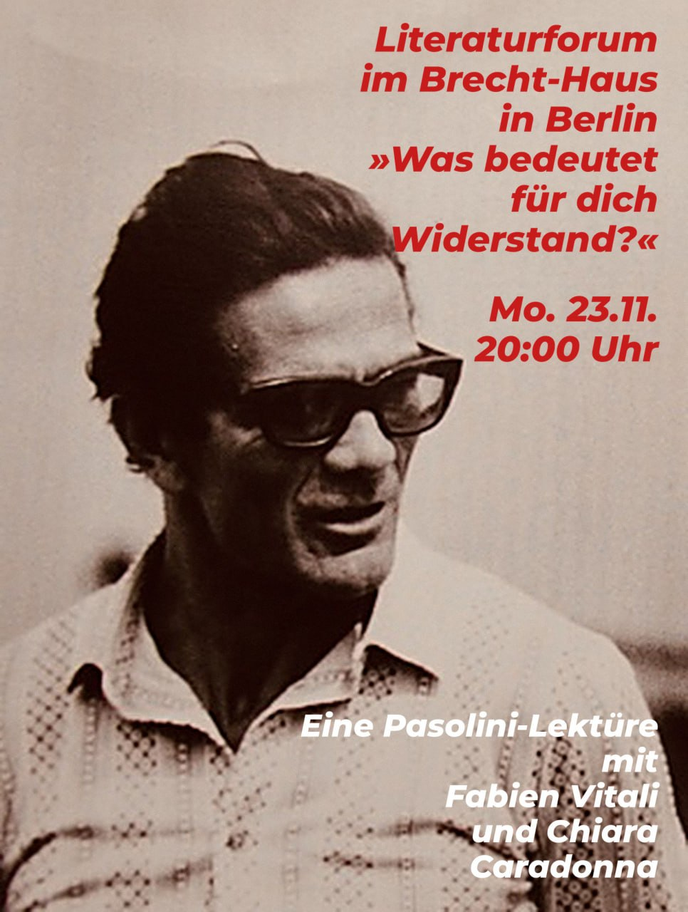

Mit Fabien Vitali und Chiara Caradonna.

Eintritt: 6,- € / ermäßigt: 4,- € // Einlass: ab 19:30 Uhr

Florenz, Spätsommer 1975. Pier Paolo Pasolini verteidigt seine Thesen zum Konsumfaschismus. Doch seine Rede bricht aus ihren pessimistischen Bahnen aus. In seinem Essay pointiert Fabien Vitali die dialektische Kraft in Pasolinis Kulturkritik. Und liest sie neu, als Geste radikalen Widerspruchs – als Suche nach einem anderen gesellschaftlichen Selbst. Ausgehend von diesem Essay diskutieren Chiara Caradonna und Fabien Vitali über Pasolinis (dichterische) Positionen und darüber, was Widerstand heute bedeuten kann.

In Kooperation mit Helle Panke e.V.

[Zur Website des Brecht-Hauses.](https://lfbrecht.de/event/was-bedeutet-fuer-dich-widerstand-eine-pasolini-lektuere/)

